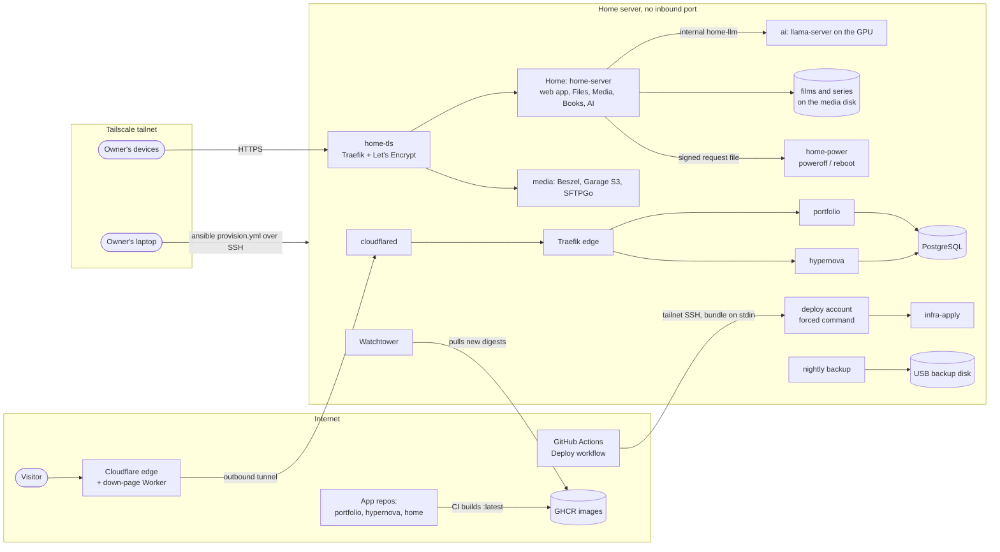

# infra

Ansible playbooks, Docker Compose stacks and shell scripts that run one person's home server:
a single Ubuntu PC on a home LAN that serves two public websites through a Cloudflare Tunnel
and, over Tailscale only, the owner's own apps (Home with its files, films, books and AI chat,
file storage, a status dashboard, local LLMs). Nothing on the box listens on the internet. This repository is the only thing that
configures it.

It is published as a worked example, not as a product: the values are the owner's (see
[What is specific to this setup](#what-is-specific-to-this-setup)), but the patterns (tunnel-only
ingress, a forced-command deploy key, digest-pinned rollbacks, a compose guard, signed power
requests) are meant to be reusable.

## Architecture



- **Public path.** A visitor reaches Cloudflare, which forwards over the tunnel that
  `cloudflared` on the server dialled out. `cloudflared` is the only thing that can reach Traefik,
  and Traefik routes by hostname to the portfolio or hypernova, which share one PostgreSQL.
  When the server is off, a Cloudflare Worker answers with a "server is down" page.
- **Tailnet path.** The owner's devices reach `home-tls` on the server's Tailscale address,
  which terminates HTTPS with one Let's Encrypt certificate (DNS-01, so nothing on the internet
  has to reach the server) and routes to Home, the status dashboard, S3 and the file manager.
- **Change path.** Provisioning runs from the owner's laptop. Releases run from GitHub Actions
  through a forced-command SSH key. Routine image updates need neither: Watchtower pulls them.

## How the repositories fit together

| Repository | What it is | How it meets the others |
| --- | --- | --- |
| [somethim-home/home](https://github.com/somethim-home/home) | Home, the owner's family app in Rust: `home-server` (axum) and Slint apps for desktop, Android and the web | Its CI builds `ghcr.io/somethim-home/home-server`; this repository runs it as the `home` stack, follows `:latest` with Watchtower, and gives it a signed power-request channel to the host |
| [somethim-home/home-crypto](https://github.com/somethim-home/home-crypto) | The end-to-end encryption format of Home Files, built on age and Ed25519 | Compiled into Home's server and apps; the server only stores ciphertext, which this repository backs up without the keys |
| [somethim/latchkey](https://github.com/somethim/latchkey) ([crates.io](https://crates.io/crates/latchkey)) | Sans-I/O sign-in building blocks (passwords, TOTP, passkeys, sessions) | Home's sign-in is built on it; this repository only supplies Home's keys and mail credentials as secrets |
| **infra** (this one) | The host, the stacks, the release path | The only thing that SSHes to the server |

The portfolio and hypernova are the owner's other apps, built in their own repositories; this
one only runs their images.

## The parts

- **Roles** (`roles/`, applied by `provision.yml`): `common` (packages, ufw, accounts, sshd,
  fail2ban, unattended upgrades), `tailscale`, `docker` (pinned engine, daemon settings, weekly
  prune), `gpu` (NVIDIA driver and Container Toolkit), `host` (disks, swap, service accounts,
  Wake-on-LAN, the nightly backup, Home's power control), `quiet`, `edge` (Traefik and its socket
  proxy), `watchtower`, `autoheal`, `beszel` (the status dashboard's socket proxy) and
  `snowflake` (a Tor Snowflake proxy); `host` also points the host's DNS at Cloudflare and
  Quad9 over TLS. See [docs/host.md](docs/host.md) and
  [docs/agents.md](docs/agents.md).
- **Stacks** (`stack/`, started by a release in this order): `database` (the shared
  PostgreSQL), `portfolio`, `hypernova`, `tunnel` (`cloudflared`), `ai` (llama-server), `media`
  (`home-tls`, Beszel, Garage, SFTPGo) and `home`. See [docs/stacks.md](docs/stacks.md),
  [docs/database.md](docs/database.md) and [docs/edge.md](docs/edge.md).
- **Release flow.** Actions → Deploy renders a bundle from the `production` Environment's
  secrets on the runner, joins the tailnet as an ephemeral node, and streams the bundle to the
  `deploy` account, whose key can only run `release` or `status`. On the host `infra-apply`
  checks the bundle (`infra-compose-guard` refuses anything outside the hardening rules), starts
  the stacks in order and marks the release verified only when every route, the tunnel and
  every tailnet-only binding check out. A rollback pins app images to digests; `resume` follows
  `:latest` again. See [docs/deploying.md](docs/deploying.md) and
  [docs/architecture.md](docs/architecture.md).
- **Backups.** Every night `infra-backup` writes a dated, hard-linked snapshot to an external
  USB disk: a `pg_dumpall`, the app volumes, Garage's objects, Home Files' ciphertext and the
  films' and series' metadata (never Home's keys, the videos or the AI models), keeping about
  two months. See [docs/operations.md](docs/operations.md#backups).
- **Quiet hours.** The server stands where people sleep, so between two wall-clock times a
  timer lowers the GPU's power limit and the CPU's top frequency, and restores both after. See
  [docs/host.md](docs/host.md#quiet-hours).
- **Power control.** Home can switch the server off or restart it, and nothing else: it writes
  one HMAC-signed request file into a tiny tmpfs, and a root `home-power` service checks the
  signature, freshness and a nonce before running `systemctl poweroff` or `reboot`. The key is
  made on the host by provisioning, never by a release. Wake-on-LAN brings it back. See
  [docs/host.md](docs/host.md#power).
- **The down-page Worker** (`cloudflare/down-page/`, Rust on workers-rs). It passes every request
  to the origin untouched and only replaces Cloudflare's "tunnel error" with a 503 page of its
  own. Deployed by hand with wrangler; it has no secrets. See
  [docs/edge.md](docs/edge.md#the-down-page).
- **Home** (`stack/home`): `home-server` behind `home-tls` on the tailnet only: the web app at
  `/app`, Files, Media (the film and series library on the media disk, NVENC on the GPU, TMDB),
  Books (Project Gutenberg), AI (llama-server over an internal network) and live updates over
  Server-Sent Events. Its SQLite databases in a volume, Files' ciphertext on the media disk, and
  its keys written by a one-shot container from the release's secrets. See
  [docs/stacks.md](docs/stacks.md#home); deploying it: [docs/deploy-home.md](docs/deploy-home.md).

## Running it

There is no local "dev server" for a host configuration; the checks run anywhere without a
server, the same way CI does ([`.github/workflows/checks.yml`](.github/workflows/checks.yml)):

```bash
ansible-playbook --syntax-check -i localhost, release.yml
ansible-playbook --syntax-check -i inventory/hosts.example provision.yml
bash ci/release-scripts.sh       # the host's release gate, apply script and bundle build, against fakes
bash ci/rollback-scripts.sh      # digest resolution for rollbacks
bash ci/backup-scripts.sh        # the nightly backup
bash ci/quiet-scripts.sh         # quiet hours
bash ci/power-scripts.sh         # Home's power requests
bash ci/verify-tasks.sh          # the roles' verify tasks
python3 ci/check_templates.py --self-test
python3 ci/check_access.py --self-test
(cd cloudflare/down-page && cargo test)
```

Against a real host, `ansible-playbook -u admin --ask-become-pass provision.yml --check --diff`
shows what provisioning would change.

**A deploy** has three independent paths:

1. **Provision** (`provision.yml`, from the owner's laptop over the tailnet, as `admin` with a
   sudo password) when a role changes. It holds no app secrets.
2. **Release** (Actions → Deploy → `release`) when a secret, a stack file or `production.yml`
   changes. `rollback` pins images to earlier digests, `resume` undoes that, `status` reports.
3. **Watchtower** on the host for routine app updates: an app repository pushes `:latest`,
   Watchtower pulls it and recreates the container.

[RUNBOOK.md](RUNBOOK.md) goes from BIOS settings to the first release, and covers recovery.
[docs/deploy-home.md](docs/deploy-home.md) takes a blank machine (a clean-slate reinstall) to everything live, Home included.

## Security model, in short

- **No inbound port on the internet.** Public traffic arrives through the tunnel the server
  dials out; the firewall drops new inbound connections to any Docker-published port that does
  not arrive on the Tailscale interface ([docs/architecture.md](docs/architecture.md#no-public-ports)).
- **SSH over Tailscale only**, keys only, no root login, host keys checked everywhere
  ([docs/host.md](docs/host.md#ssh-tailscale-only)).
- **Three ways in, nothing else:** `admin` (the owner, sudo with a password), `deploy` (CI, a
  forced command that can only run `release` or `status`), and Watchtower (no login, Docker
  through a socket proxy). Home's power request is a fourth, narrower channel that can only
  power off or reboot.
- **Secrets live only in the GitHub `production` Environment**, are rendered on the runner and
  land in root-owned env files read by one container each; provisioning holds none.
- **The compose guard** refuses any stack that publishes an unexpected port, joins an
  unexpected network, mounts an unexpected path, runs privileged or skips the hardening
  (read-only root, dropped capabilities, `no-new-privileges`, memory limits).
- Home Files' data is end-to-end encrypted by the clients; the server and its backups only see
  ciphertext. Its threat model is
  [home-crypto's docs/threat-model.md](https://github.com/somethim-home/home-crypto/blob/master/docs/threat-model.md).

Reporting a problem: [SECURITY.md](SECURITY.md).

## What is specific to this setup

**The owner's own values** (change them to reuse anything): the domains (`arbikullakshi.com`
and its subdomains), the contact address, the GHCR image repositories, the host's tailnet name,
disk UUIDs, NIC name, GPU model and driver branch, time zone and quiet hours, the uids, and the
deploy public key. They live in [`production.yml`](production.yml),
[`roles/common/files/deploy_key.pub`](roles/common/files/deploy_key.pub), the gitignored
`inventory/hosts` and the GitHub Environment; a few are written straight into stack templates.
[docs/variables.md](docs/variables.md) lists every one with an example value, and
[`production.example.yml`](production.example.yml) is a copy with example values.

**Reusable as patterns:** the tunnel-only edge and its verification, the forced-command
release gate with a deterministic bundle, digest-pinned rollback and resume, the compose guard,
the tailnet-only port binding checks, the nightly hard-link snapshots, quiet hours, the signed
power-request file, the down-page Worker, and the CI harnesses that test all of it against
fakes.

**Not in the repository:** secrets, `inventory/hosts`, and the owner's private planning and
audit notes (some comments cite them as `plans/NNN`).

## In detail: the single deployer

The **one** repo that configures the server: a dedicated PC on the owner's home LAN, running
Ubuntu Server 26.04 LTS, with no port open to the internet. The public reaches the sites only
through a **Cloudflare Tunnel** the server dials out to; SSH works only over **Tailscale**. It
provisions the host, runs the edge Traefik proxy and the autonomous agents, and releases every
stack: the shared `database`, two applications, `portfolio` and `hypernova`, the `tunnel`, and
for the owner alone, over the tailnet only, `ai` (llama-server on the GPU, the engine of Home's
AI), `media`
(the Beszel status dashboard, Garage S3 storage with the SFTPGo file manager on top, and
`home-tls`, which serves each at its own https name under `home.arbikullakshi.com` on the
tailnet) and `home` (Home, the owner's own app, at `https://home.arbikullakshi.com/`). It also
mounts the media and backup disks and backs up every night.

The app repos (`hypernova`, `portfolio`, `home`) are **build-only** — their CI builds images and
pushes them to GHCR. They never deploy. Watchtower on the server pulls a new `:latest` and
recreates the container.

```
visitors ──HTTPS──▶ Cloudflare ◀══ tunnel (outbound) ══ cloudflared ─▶ Traefik :80 ─▶ portfolio · hypernova ─▶ PostgreSQL
                                                        └──────────── home server, no open port ────────────┘
hypernova ─┐  build :latest → GHCR ┐   Watchtower (on the server) sees the new
portfolio ─┘  build :latest → GHCR ┘   digest → docker pull + recreate container
          ▲
          │ provision.yml (owner's laptop)  ·  release bundle (Deploy workflow)
        infra (this repo) — the only thing that SSHes to the box, over Tailscale only
```

## How it deploys

- **Provisioning** — `provision.yml`, from the owner's laptop, as `admin` with a sudo
  password, over the tailnet. Packages, firewall, accounts, sshd, Tailscale, Docker, the
  NVIDIA driver and Container Toolkit, power settings, the edge proxy (no published port), Watchtower, autoheal and Beszel's socket proxy. No secrets. The very
  first run bootstraps a fresh Ubuntu install over the LAN as the installer's account
  ([RUNBOOK.md](RUNBOOK.md#5-first-provision-over-the-lan)).

  ```bash
  cp inventory/hosts.example inventory/hosts
  ansible-playbook -u admin --ask-become-pass provision.yml
  ```

- **Releases** — GitHub → **Actions → "Deploy" → Run workflow** (`release`, `resume`,
  `rollback`, `status`). The runner renders a bundle from the `production` Environment and
  streams it to the `deploy` account, whose one key is forced to `release` or `status`. The
  host checks the bundle, starts `database`, `portfolio`, `hypernova`, `tunnel`, `ai`,
  `media` and `home` in that order, and marks the release verified only when everything is healthy, Traefik routes
  every domain to its app, the tunnel is connected and each tailnet-only port is bound to the
  Tailscale address alone. Run one when a secret (the Cloudflare Tunnel
  token included) or a stack file changes — not for routine image updates.
- **Watchtower** — on the host, with no login: follows `:latest` for the app containers.
  A rollback pins digests, which pauses it for those apps until `resume`.

Three access paths, and nothing else: `admin` (owner, sudo with a password), `deploy` (CI,
forced to `release|status`), and Watchtower (no login, Docker through a socket proxy). Besides
them, Home may ask the host for a poweroff or reboot with one signed file, nothing else
([docs/host.md](docs/host.md#power-requests-from-home)).
Inbound ports (other than SSH and the owner's tailnet-only ports, on the Tailscale address),
password login and root login are off; host keys are checked everywhere.

## Layout

```
production.yml         facts about the host: tailnet name, Ubuntu release, Docker major, domains, image repos
provision.yml          the host: owner's laptop, over the LAN once, then over Tailscale
release.yml            renders the release bundle on the runner; build-bundle.sh packs it
build-bundle.sh        deterministic bundle + manifest; refuses unpinned third-party images
release-images.sh      turns rollback targets into digest pins
ansible.cfg            auto-loaded; points at inventory/hosts, checks host keys
inventory/             hosts.example only — inventory/hosts is gitignored
roles/                 common · tailscale · docker · gpu · host · quiet · edge · watchtower · autoheal · beszel · snowflake
roles/common/files/    infra-deploy-gate · infra-apply · infra-compose-guard (the host side of a release)
stack/                 database · portfolio · hypernova · tunnel · ai · media · home (compose files and env templates)
tasks/                 placeholder-guards · provision-checks · ssh-route
ci/                    the release path, verify tasks and access/template rules, tested against fakes
.github/workflows/     deploy.yml, the Deploy workflow; checks.yml, the deploy lint
RUNBOOK.md             BIOS to first release, DNS switch-over, releases, rollback, recovery, GPU, AI, media, disks, restore
docs/deploy-home.md    the owner's clean-slate reinstall: a blank machine to everything live
docs/                  why any of it is the way it is
cloudflare/down-page/  the "server is down" Worker (Rust, workers-rs), deployed by hand with wrangler
production.example.yml production.yml with example values (read by nothing; for forks)
SECURITY.md            how to report a problem
```

## Documentation

[RUNBOOK.md](RUNBOOK.md) says what to do, in order. The code says what happens.
[`docs/`](docs/README.md) says why, and what breaks if you change it.

- [architecture.md](docs/architecture.md) — the home server and the tunnel, access paths, stacks and their order, releases, env files, networks, public vs tailnet-only, no public ports
- [deploy-home.md](docs/deploy-home.md) — **a clean-slate reinstall**: the OS, BIOS, provisioning, Tailscale, the secrets, the AI models, the release, Home's setup, the first-run checks, restoring old backups, the down page, rollback
- [deploying.md](docs/deploying.md) — the Deploy workflow, every secret and variable, what the host checks, provisioning tags, adding a project
- [database.md](docs/database.md) — the shared PostgreSQL
- [stacks.md](docs/stacks.md) — what is peculiar about each application, the tailnet-only `ai`, `media` and `home` stacks, and the apps retired on 2026-10-20
- [edge.md](docs/edge.md) — the Cloudflare Tunnel, Traefik, its socket proxy, client IPs, routing conventions, the "server is down" Worker
- [host.md](docs/host.md) — Tailscale-only SSH, accounts and the LAN bootstrap, sshd, firewall, fail2ban, patching, power and Wake-on-LAN, quiet hours, encrypted DNS, Docker, the GPU, the disks
- [agents.md](docs/agents.md) — Watchtower, autoheal, Beszel's socket proxy, the prune timer, re-pinning images
- [operations.md](docs/operations.md) — short recipes outside the runbook, the nightly backup

## Licence

Licensed under either of [Apache License, Version 2.0](LICENSE-APACHE) or [MIT license](LICENSE-MIT)
at your option.

The repository bundles no third-party files: the container images, Ansible collections, packages
and fonts it names are fetched at deploy time (or by the visitor's browser) under their own
licences.

Unless you explicitly state otherwise, any contribution intentionally submitted for inclusion in
this repository by you, as defined in the Apache-2.0 license, shall be dual licensed as above,
without any additional terms or conditions.
